# mini-software-factory

**A one-person software factory: the setup I use to build real products with coding agents, as a template you can copy.**

A coding agent writes code. A *software factory* is the system around it: how ideas come in, how they turn into specs, how the agent is told about your codebase, what it is never allowed to do, how its work gets checked, and how what happens in production feeds the next idea. The agent is one station. The factory is the loop.

This repo is the loop I run on my own apps (a habit tracker with real users, plus a handful of smaller products), stripped of anything product-specific so you can drop it into your own repo.

> Personal project by [Jinto Jose](https://www.linkedin.com/in/jintojose). Not my employer's practice or view. Built on Claude Code, but the artifact chain works with any agent that reads files.

📐 **Diagram and walkthrough:** [docs/factory.png](docs/factory.png) · 📚 **The research behind it:** [ai-native-sdlc-playbooks](https://github.com/jintomjose/ai-native-sdlc-playbooks) · 📏 **How I measure it:** [agentic-benchmarks](https://github.com/jintomjose/agentic-benchmarks)

---

## The loop

```mermaid
flowchart LR
    S["Signal<br/>idea · user feedback · incident"] --> G["Grill<br/>/capture-intent asks the hard questions"]
    G --> I["intent.md<br/>problem in the asker's words"]
    I --> SP["spec.md<br/>/write-spec · policy flagged inline"]
    SP --> P["plan.md<br/>approved before any code"]
    P --> B["Build<br/>agent + CLAUDE.md + skills<br/>hooks block what must never happen"]
    B --> V["Verify<br/>tests · evals · verifier subagent"]
    V --> R["Review<br/>REVIEW.md · reviewer subagent<br/>a human approves, never the author"]
    R --> D["Ship<br/>preview → production"]
    D --> O["Observe<br/>analytics · error logs · agents in production"]
    O --> M["Measure<br/>delivery vs plan (agentic-benchmarks)"]
    O -->|"breach or incident"| IR["incident-record.md"]
    IR --> I
```



Every station ends by committing a file the next station reads. The chain of commits is the audit trail: who asked for what, what the agent produced, and who approved it. The idea comes from Anthropic's [AI-native SDLC playbook](https://claude.com/blog/the-ai-native-sdlc-playbook); this repo is my working version of it at the scale of one person.

## Stations and the files behind them

| # | Station | File | What it does |
|---|---|---|---|
| 1 | **Grill** | [`.claude/skills/capture-intent`](.claude/skills/capture-intent/SKILL.md) | Interviews you like an analyst before anything is written down: who has the problem, how you'll know it's solved, what must not change |
| 2 | **Intent** | [`factory/templates/intent.md`](factory/templates/intent.md) | The problem in the originator's words. Committing it starts design |
| 3 | **Spec** | [`.claude/skills/write-spec`](.claude/skills/write-spec/SKILL.md) → [`spec.md`](factory/templates/spec.md) | Requirements and design in one session, with `[NEEDS CLARIFICATION]` and `[POLICY]` flags inline |
| 4 | **Plan** | [`factory/templates/plan.md`](factory/templates/plan.md) | Files, order of work, tests. **Approved before any code** |
| 5 | **Context** | [`CLAUDE.md`](CLAUDE.md) | Commands, conventions, architecture and known mistakes. Read at the start of every session |
| 6 | **Guardrails** | [`.claude/settings.json`](.claude/settings.json) + [`.claude/hooks/`](.claude/hooks/) | Deterministic. Blocks edits to protected paths and secrets in any file. Skills advise, hooks enforce |
| 7 | **Verify** | [`.claude/agents/verifier.md`](.claude/agents/verifier.md) + [`evals/`](factory/templates/evals/README.md) | A separate subagent runs the checks and reports. The agent configuration itself gets regression-tested |
| 8 | **Review** | [`REVIEW.md`](factory/templates/REVIEW.md) + [`.claude/agents/reviewer.md`](.claude/agents/reviewer.md) | AI review against a written standard before a human looks. The author can't approve its own work |
| 9 | **Maintain** | [`bands.yaml`](factory/templates/bands.yaml) + [`incident-record.md`](factory/templates/incident-record.md) | How far an agent may act on a production signal. Every incident becomes the next `intent.md` and a new eval |
| + | **Check the chain** | [`factory/check_chain.py`](factory/check_chain.py) | Fails CI if a change has no intent, spec and approved plan behind it |

A worked example of one full pass, a GDPR "delete my account" feature, lives in [`work/account-deletion/`](work/account-deletion/).

## Use it in your repo

```bash
# copy the factory into an existing repo
git clone https://github.com/jintomjose/mini-software-factory /tmp/msf
cp -r /tmp/msf/.claude /tmp/msf/factory /tmp/msf/CLAUDE.md your-repo/
```

Then adopt it in this order. Every source I studied says the same: context first, enforcement second, breadth last.

1. **Fill in `CLAUDE.md`.** The highest-leverage file, and it pays back on day one with or without the rest.
2. **Turn on the hooks.** Edit `PROTECTED` in `.claude/hooks/protect_paths.py` for your repo.
3. **Run one feature through the chain**: `/capture-intent` → `/write-spec` → plan mode → build → `/review-pr`.
4. **Start `evals/` with three real past mistakes.** Grow toward 20–50.
5. **Leave `bands.yaml` until last.** Letting agents act on production signals is the furthest from normal practice and the easiest to get wrong.

## What it has done

The factory is real, not a diagram. On my habit tracker:

- **2 hours:** migrating the app off a no-code platform onto an owned stack (Vite + React, Supabase, Vercel), plus two new features along the way.
- **3 days:** the 118 story points my original sprint plan had spread across 6 sprints (about 10 weeks). That's calendar time, not labour hours, and plan vs actual, not a controlled experiment. The method is open in [agentic-benchmarks](https://github.com/jintomjose/agentic-benchmarks).
- **~89%** of that scope built by the agent. The other 11% stayed human on purpose: pricing, product taste, killing a bad idea, and paperwork.
- **An agent in production:** a daily activation job that nudges users who signed up but never checked in, with a 7-day frequency cap per user.

## What stays human

The factory moves the work, not the accountability. I still:
- decide what's worth building (the Grill station exists to slow me down there, not speed me up)
- approve every plan before code is written
- approve every merge to production
- own anything involving money, users' data or a legal entity

The bottleneck moved. It used to be writing code. Now it's knowing what to build, writing a spec good enough for an agent to execute, and reviewing fast enough to keep up.

## Credits

- Artifact chain: Anthropic, [The AI-native SDLC playbook](https://claude.com/blog/the-ai-native-sdlc-playbook) (Aug 2026). The template field structures here are my own reconstruction, not Anthropic files.
- `[NEEDS CLARIFICATION]` markers and stable `FR-001` IDs: borrowed from GitHub's [Spec Kit](https://github.com/github/spec-kit) (MIT).
- The grilling idea: Matt Pocock's [`grill-me` skill](https://github.com/mattpocock/skills). `capture-intent` is my own version, aimed at intent rather than design.
- "Software factory" framing: [Factory](https://factory.com/news/software-factory), [BCG Platinion](https://www.bcgplatinion.com/insights/the-agentic-software-factory), [Atlassian](https://www.atlassian.com/blog/ai-at-work/ai-sdlc-transformation-playbook), and many talks at AI Engineer Paris 2026.

MIT licence. Copy anything.
